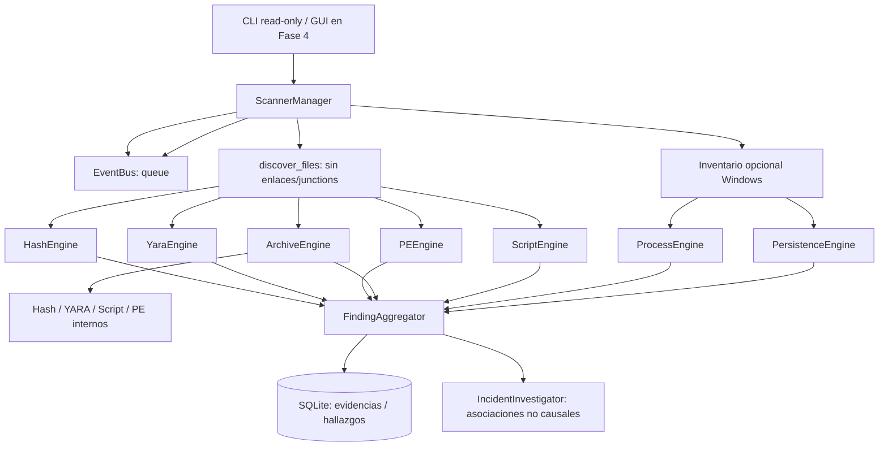

# Arquitectura Fase 3

## Contrato

`DetectionEngine.scan(ScanTarget) -> list[Finding]` es la interfaz común. `ScanTarget` distingue `file`, `process` y `persistence`, con metadata local de inventario. Los motores no pueden mitigar ni modificar el sistema. Los resultados se agregan **por objetivo real**, incluidos miembros internos `zip::nombre`. El SHA del ZIP nunca se copia al miembro; se usa su propio digest cuando existe.

`ScanSummary.scanned_files` cuenta archivos físicos; `scanned_system_targets` cuenta elementos del inventario del sistema. Errores/omisiones quedan registrados como parcial, no benigno.

## Investigación

`IncidentInvestigator` enlaza nombres de ejecutables en distintos hallazgos. La relación se etiqueta como asociación, **no** prueba de causalidad. Para reconstrucción de la secuencia real de infección se necesitará telemetría de eventos históricos, Sysmon/ETW si estuvieran disponibles, timestamps fiables y aprobación explícita de lectura.

## Prioridades después de Fase 3

1. Completar análisis profundo 7z con worker de proceso aislado, memoria y tiempo estrictos; endurecer backend RAR.
2. Telemetría histórica + registro de fallos del inventario y detección de persistencia nueva frente a baseline firmado.
3. Verificación del sujeto/autor de certificado para permitir una protección robusta de System32 firmado por Microsoft.
4. Fase 4 GUI + consentimiento granular. Fase 5 restauración, cuarentena, reparación. Fase 6 VM Windows y compilación.
